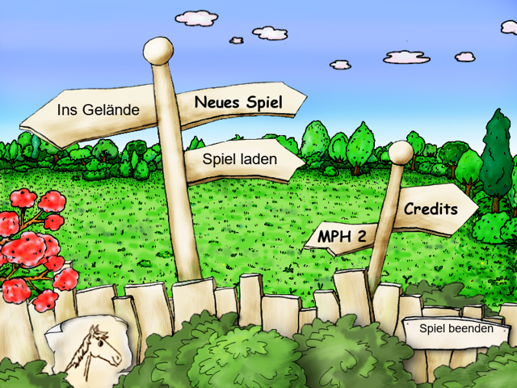

# Mein Pferdehof for Windows 11

A standalone re-implementation of the 2006 German horse-farm game *"Pferd & Pony – Mein Pferdehof"* (emme,
Macromedia Director 8.5). It runs on Windows 10/11 without installation and without the original copy protection.
It is not an emulator: a custom Director file parser, a Lingo bytecode VM, a pygame-based player and a port of the
riding mini-game read your original game files and run the original game logic directly.

  

> **You need your own copy of the game.** This repository and release contain no game data. On first start,
> `MeinPferdehof.exe` opens a wizard that reads your original CD (as a drive, `.cue`/`.bin`, `.iso`, or a `.7z`/`.zip`
> package of it) and prepares only the needed game files.

Status: work in progress, but extensively tested (250+ automated tests, a 1200-in-game-day soak run, and all five
in-game goals reached through the UI). See the German [README](README.md) for the full walkthrough, controls and
screenshots.

*Mein Pferdehof is a game by emme. This is an independent, non-commercial fan project, not affiliated with or endorsed
by the rights holders. The original copy protection is neither circumvented nor used.*
