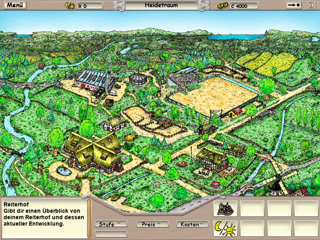
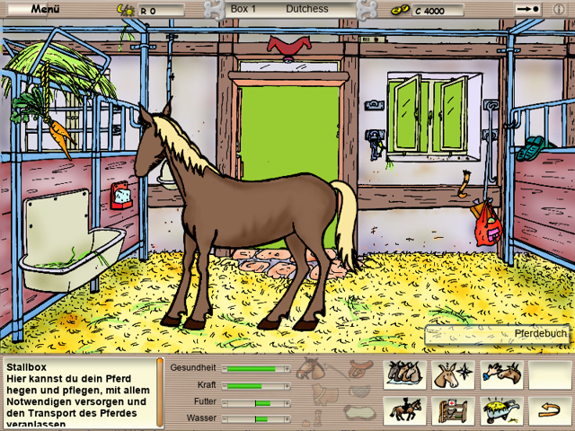
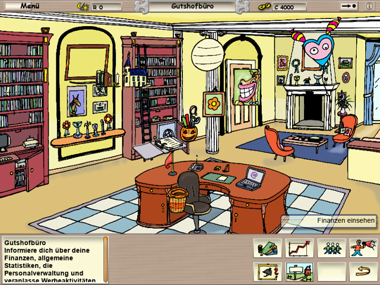
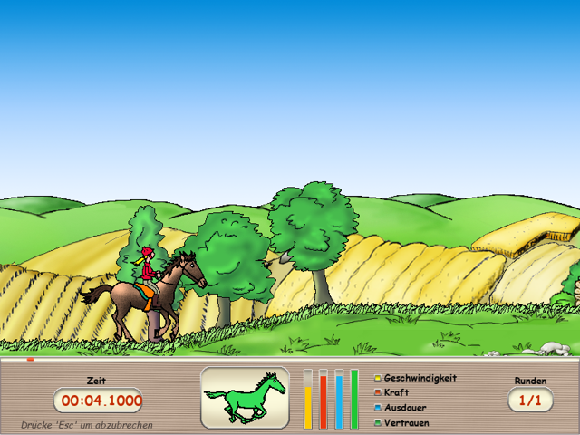
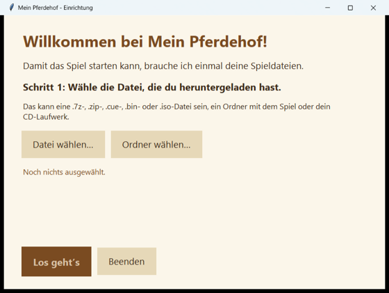
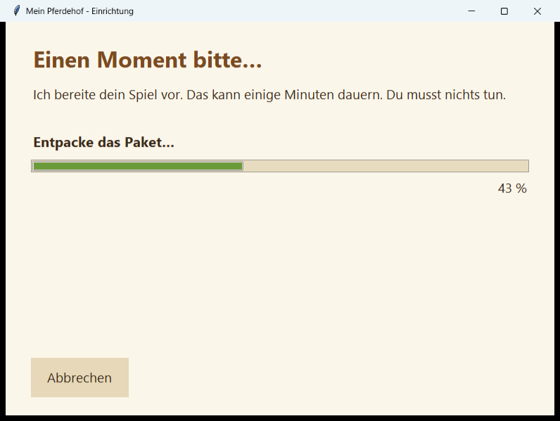

<h1 align="center">Mein Pferdehof für Windows 11</h1>
<h3 align="center">Eine eigenständige Neuimplementierung von „Pferd &amp; Pony – Mein Pferdehof" (2006)</h3>

  
  
  
  

  

<table align="center">
<tr>
<td> Hofkarte</td>
<td> Stall</td>
<td> Gutshofbüro</td>
<td> Reit-Minispiel</td>
</tr>
</table>

Alle Bildschirmfotos sind Aufnahmen dieser Neuimplementierung, keine Originaldateien.

Das Spiel läuft unter Windows 10/11 ohne Installation, ohne DirectX-Altlasten und ohne den originalen Kopierschutz.
Es wird nicht emuliert. Ein eigener Player liest die Originaldateien und führt die originale Spiellogik aus.

> [!NOTE]
> **Du brauchst deine eigene Kopie des Spiels.** Dieses Projekt enthält keine Originaldaten. Lege die Dateien deiner
> originalen Spiele-CD bereit (siehe [Schritt für Schritt](#so-kommst-du-zum-spiel-schritt-für-schritt)).

## Inhalt

- [Funktionen](#funktionen)
- [So kommst du zum Spiel (Schritt für Schritt)](#so-kommst-du-zum-spiel-schritt-für-schritt)
- [Bedienung](#bedienung)
- [Entwicklungsstand](#entwicklungsstand)
- [Wie es funktioniert](#wie-es-funktioniert)
- [Änderungsverlauf](CHANGELOG.md)
- [Rechtliches](#rechtliches)

## Funktionen

- Alle Spielbereiche des Originals: Hofkarte, Stall, Schmied, Arzt, Händler, Zucht, Gut mit Finanzen und Statistik
- Speichern und Laden wie im Original, Spielstände unter `%APPDATA%\PferdeHof`
- Das Reit-Minispiel mit 15 Levels, Gangarten, Sprüngen, Ausdauer und Weggabelungen, portiert aus dem Original-Code
- Läuft als Fenster oder im Vollbild (F11), skalierbar, in 800×600 mit flüssigen 30 Bildern pro Sekunde
- Keine Python-Installation und keine DirectX-Runtime nötig
- Über 300 automatische Tests, dazu ein Langzeitlauf über 1200 Spieltage

## So kommst du zum Spiel (Schritt für Schritt)

Du brauchst nur zwei Dinge: **das Programm** und **die Spieldateien**. Beides dauert zusammen etwa 10 Minuten.

### Schritt 1: Das Programm herunterladen

1. Lade `MeinPferdehof-Windows.zip` herunter: **[MeinPferdehof-Windows.zip](https://github.com/KrabbiAI/Pferd-Pony-Mein-Pferdehof/releases/latest/download/MeinPferdehof-Windows.zip)**
   ([alle Versionen](https://github.com/KrabbiAI/Pferd-Pony-Mein-Pferdehof/releases))
2. Mach einen Rechtsklick auf die heruntergeladene Datei und wähle **„Alle extrahieren…"**.
3. Es entsteht ein Ordner. Öffne ihn.

### Schritt 2: Die Spieldateien besorgen

Das Spiel selbst ist nicht im Programm enthalten. Du brauchst die Dateien deiner **eigenen Spiele-CD** als
Abbild-Datei (`.bin` und `.cue`, oder als `.7z`- oder `.zip`-Paket, oder als `.iso`).

- Hast du die CD selbst? Lege sie ein. Das Programm kann direkt vom CD-Laufwerk lesen.
- Hast du eine Abbild-Datei? Speichere sie irgendwo, zum Beispiel auf dem Desktop.
- Download der Spieldateien: **[HIER DEN DOWNLOAD-LINK DER SPIELDATEIEN EINFÜGEN]**

<!-- TODO für den Repo-Besitzer: Den Link (z. B. archive.org) oben in beide Klammern einsetzen.
     Die Verantwortung für den verlinkten Inhalt liegt beim Repo-Besitzer. -->

### Schritt 3: Starten

1. Doppelklicke im Programmordner auf **`MeinPferdehof.exe`**.
2. Beim allerersten Start begrüßt dich dieses Fenster. Klicke auf **„Datei wählen…"** und wähle die Datei aus
   Schritt 2 aus. Es ist egal, ob das ein Paket (`.7z`, `.zip`), ein CD-Abbild (`.cue`, `.bin`, `.iso`), ein fertiger
   Ordner oder dein CD-Laufwerk ist. Dann auf **„Los geht's"**.

  

3. Jetzt bereitet das Programm alles allein vor. Du musst nichts tun.

  

4. Warte, bis **„Fertig!"** dasteht. Das dauert ein paar Minuten, danach startet das Spiel von allein.

Beim nächsten Mal startest du nur noch `MeinPferdehof.exe`. Das Auswählen musst du nur einmal machen.

**Klappt etwas nicht?** Das Fenster erklärt in einfachen Worten, was schiefgelaufen ist und was du tun kannst. Häufig
hilft es, die Datei noch einmal herunterzuladen oder mehr Platz auf der Festplatte freizumachen (etwa 2 GB nur während
der Vorbereitung, danach rund 700 MB).

Systemvoraussetzungen: Windows 10 oder 11 (64 Bit).

### Für Fortgeschrittene

Der Starter sucht die Daten in dieser Reihenfolge: `--data-root <Ordner>`, Umgebungsvariable `PFERDHOF_DATA`,
Ordner `GameData\` neben der exe, zuletzt gewählter Ordner. Von Hand vorbereiten geht mit
`MeinPferdehof.exe --prepare <Datei>`. Die Spieldaten werden nur gelesen und nie verändert.

## Bedienung

Die Maus funktioniert wie im Original (Klicken, Ziehen, Menüs). In Textfeldern wird normal getippt.
Mit **F11** wechselst du zwischen Fenster und Vollbild.

**Reit-Minispiel**

| Taste | Wirkung |
|---|---|
| Pfeil rechts / links | antreiben / zügeln |
| Pfeil hoch / runter | Gangart wechseln |
| Leertaste oder Z | springen |
| Enter | an einer Weggabelung abbiegen |
| Esc | pausieren (Enter danach bricht ab) |

**Kommandozeile:** `--fullscreen`, `--no-sound`, `--movie <name>`, `--data-root <Ordner>`,
`--headless --frames N --screenshot x.png` (für Tests). Ein Fehlerprotokoll steht in `%APPDATA%\PferdeHof\player.log`.

## Entwicklungsstand

Das Projekt ist in Arbeit. Getestet, mit über 250 automatischen Tests und mehreren Durchspiel-Durchläufen:

- [x] Start, Intro, Hauptmenü, Spielerwahl, Hofkarte und alle Gebäude
- [x] Speichern und Laden von Spielständen
- [x] Reit-Minispiel: alle 15 Level, über die Menüs erreichbar
- [x] Zeit, Zucht, Wirtschaft, Personal, Werbung: ein Langzeitlauf über 1200 Spieltage lief ohne Fehler
- [x] Alle fünf Spielziele bis zum Champion-Turnier sind erreichbar
- [ ] Pixelgenauer Rich-Text und einzelne Optikdetails
- [ ] Ausführliches Spielen über Stunden mit echten Spielern

## Wie es funktioniert

Das Original ist ein Spiel in Macromedia Director (2006): Bilder, Sounds und die Spiellogik stecken in den
Filmdateien der CD. Die mitgelieferte `Starter.exe` ist kopiergeschützt und läuft unter Windows 11 nicht. Diese
Neuimplementierung liest stattdessen die Filmdateien selbst, führt die enthaltene Spiellogik (Lingo-Bytecode) mit
einer eigens dafür gebauten Maschine direkt aus und stellt sie in einem eigenen Fenster dar. Der Kopierschutz der
Original-`Starter.exe` wird dabei weder umgangen noch gebraucht. Das Reit-Minispiel ist ein eigenständiges
Unterprogramm des Originals; seine Spielmechanik wurde eigens nachgebaut.

## Rechtliches

„Pferd & Pony – Mein Pferdehof" ist ein Spiel von emme. Dieses Projekt ist ein unabhängiges, nicht-kommerzielles
Fan-Projekt. Es steht in keiner Verbindung zu den Rechteinhabern und wird von ihnen weder unterstützt noch autorisiert.
Es werden keine urheberrechtlich geschützten Original-Inhalte (Grafiken, Sounds, Texte, Programme) mitgeliefert.
Der Kopierschutz der Original-`Starter.exe` wird weder umgangen noch genutzt. Eine Weitergabe der Spieldaten ist nicht erlaubt.
